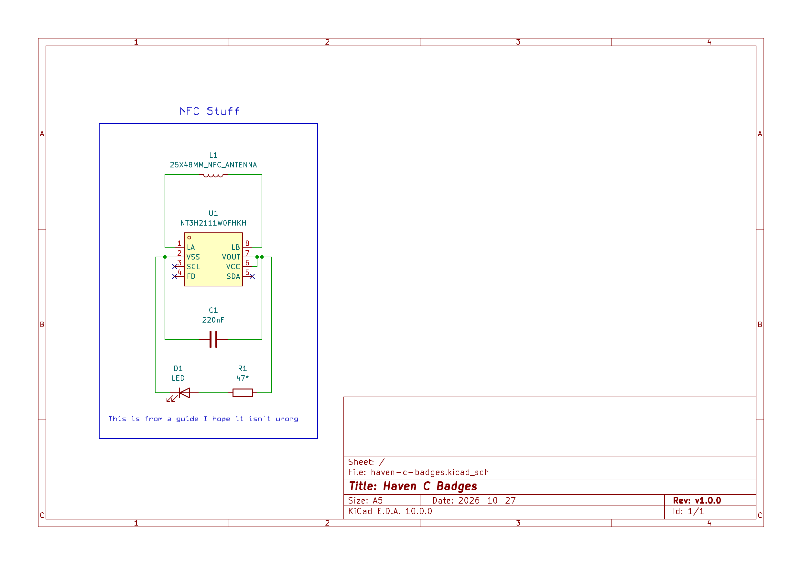

# haven-c-badges
Badges for the Haven of artist & engineers

## Schematic

## BOM
The same as the jams guide.
|Item|Description|Cost|Link|
|---|---|---|---|
|KT-0805Y|Yellow SMD LED|||
|NT3H2111W0FHKH|NFC Chip|||
|CL10B224KA8NNNC|SMD Ceramic Capacitors|||
|0603WAF470JT5E|SMD Resistors|||

## Rationale
This will be a list of every design decision I made.

## Derivatives
This is what I used in the making of this project. ~~Also because I need to study calculus rn~~
- Jams.hackclub.com
- github.com/notaroomba/cybercard

